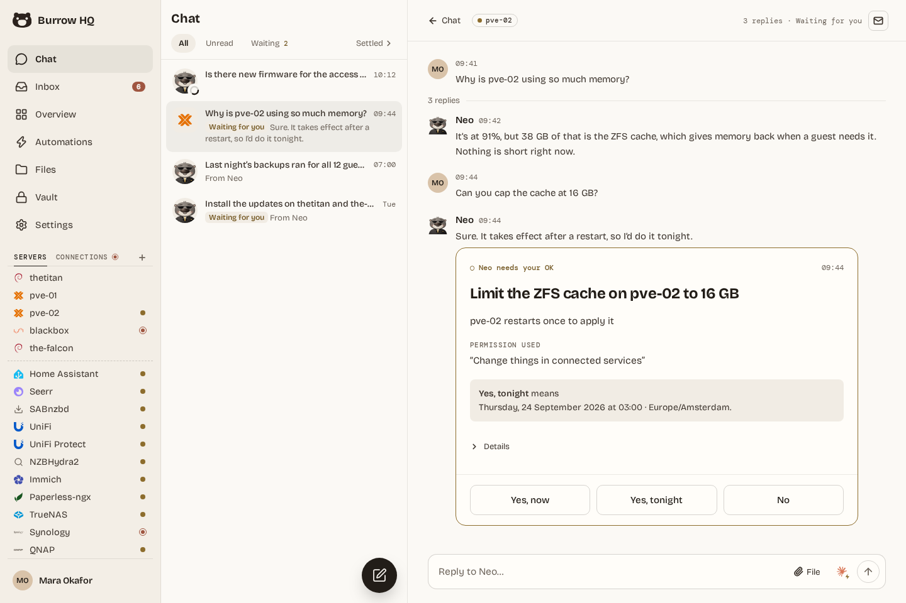
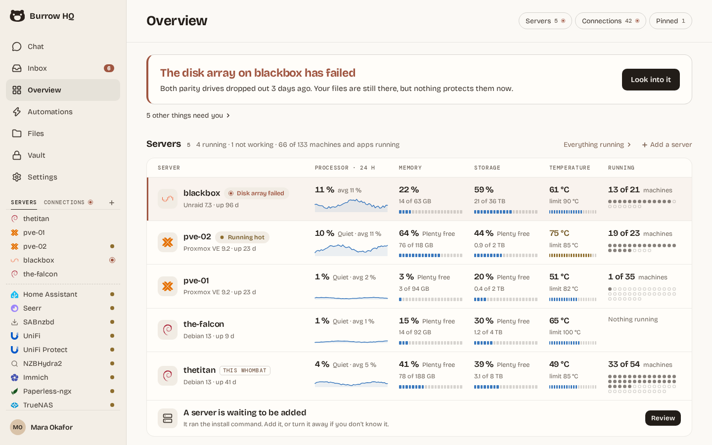
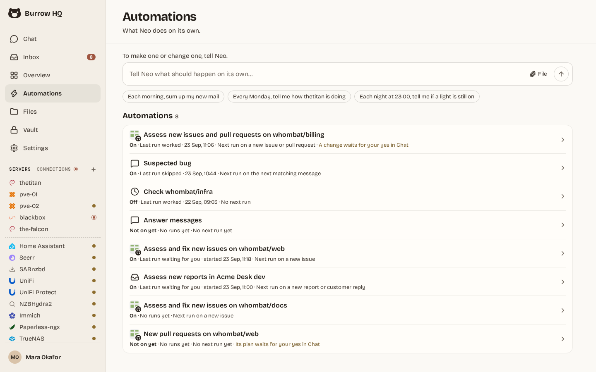
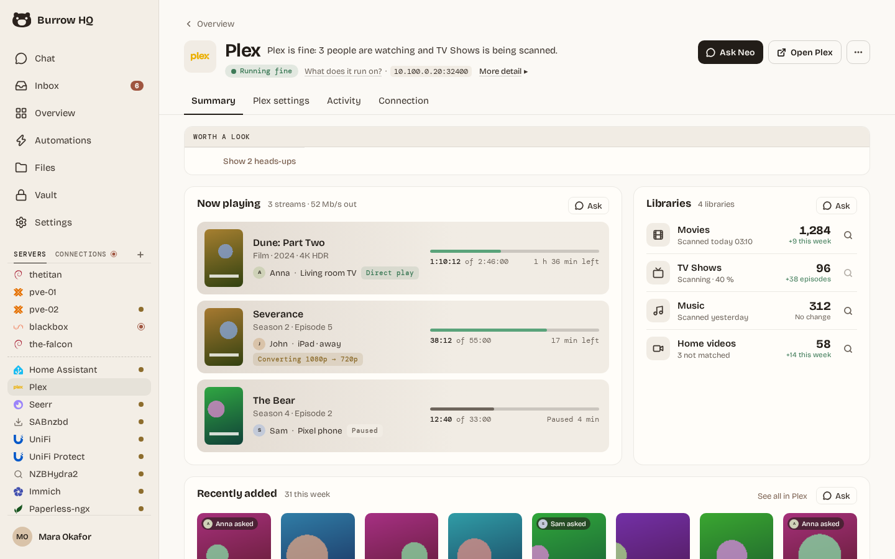
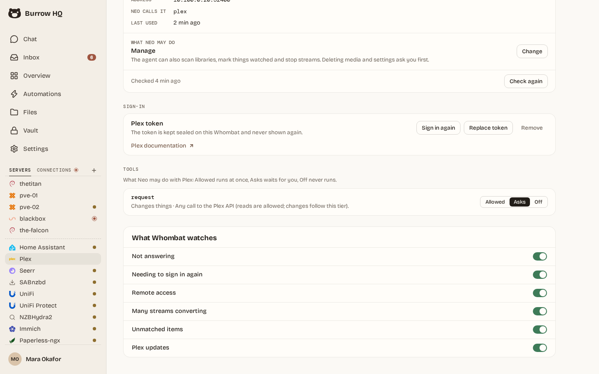
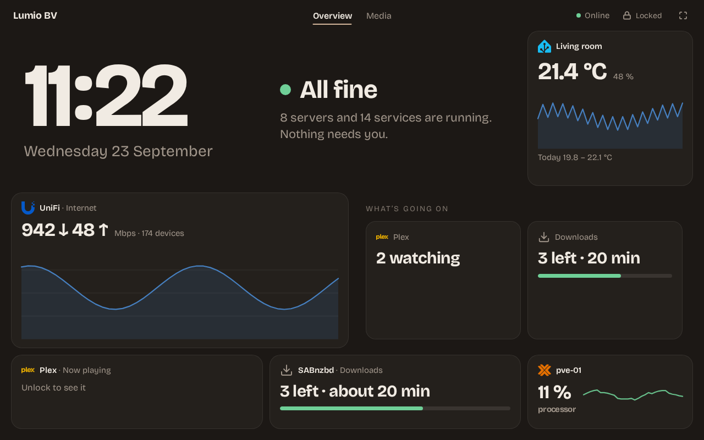
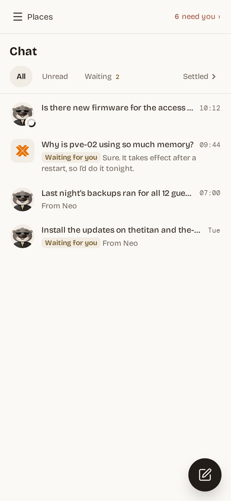
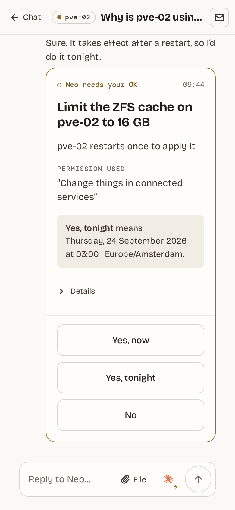

<div align="center">

<h1><picture><source media="(prefers-color-scheme: dark)" srcset="packages/brand/assets/svg/whombat-logo-horizontal-paper.svg"></picture></h1>

**The AI assistant that looks after everything you run.**

Whombat is a small computer in your home or office with one AI assistant on it.<br>
It keeps an eye on your servers, network, mail and services, fixes what it can and asks you first about anything important.<br>
Your data lives on the box, and it works with the Claude or ChatGPT you already pay for.

[](LICENSE)
[](https://github.com/CybexBV/whombat-releases/releases)
[](https://whombat.com/download)
[](#install)

[Download](https://whombat.com/download) · [Website](https://whombat.com) · [Tour](#a-tour) · [FAQ](#questions) · [Docs](docs/development.md) · [Security](SECURITY.md)

</div>

> **Whombat is in beta.** It runs every day on its makers' own boxes and new releases come often, but expect rough
> edges. Tell us what you run into in the [issues](https://github.com/CybexBV/whombat/issues).

<br>

<picture>
  <source media="(prefers-color-scheme: dark)" srcset="docs/readme/chat-dark.png">
  
</picture>

<br>

## Why Whombat

- **Yours, on your own hardware.** A small PC or a virtual machine you own. Your data stays on the box, and it only
  makes outgoing connections, so there is nothing to open on your router.
- **An assistant, not a chatbox.** One assistant, Dusty by default, with a name and face you pick. It answers in
  short, plain English, with more detail when you ask. Chat works like your mail: new replies are marked, and you
  settle a thread when it's done.
- **It asks first.** For anything important you get *Yes, now*, *Yes, tonight* or *No*. For each server and service
  you choose *Just watch*, *Ask me first* or *Go ahead*. Every action is signed into an audit log.
- **Every server, one line to install.** A small agent opens no ports and calls out to your Whombat: health, disks,
  “full in 9 days” forecasts, updates, Docker, Incus, libvirt and Proxmox VE, with VM consoles and shells in your
  browser.
- **Connects to what you already run.** More than 50 services have their own page: Home Assistant, Proxmox VE, UniFi,
  Synology, TrueNAS, Plex, Immich, Paperless, Pi-hole and more, plus your mail and calendar. Anything else, any API or
  MCP server, you connect by asking.
- **Automations by asking.** Say what should happen and when. The assistant writes it up as a plan you check and turn
  on.
- **Backups without the homework.** Every night, to your NAS (where the box can add backups but not delete them), a
  USB disk or a bucket, locked with your passkey. Bring your whole Whombat back on a new box from the app.
- **Your AI, no margin.** Sign in with your Claude or ChatGPT subscription, use an API key or connect a custom
  OpenAI-compatible AI model (services like OpenRouter or Google Gemini, or a server on your own network). Your sign-in
  stays on the box.

## Install

1. **Download** the installer from [whombat.com/download](https://whombat.com/download): one ISO for x86-64 computers
   with UEFI, about 4 GB. Check it against its SHA-256 file if you like (`sha256sum -c whombat-installer.iso.sha256`).
2. **Write it or attach it.** For a PC: write it to a USB stick of 8 GB or more with a raw (“DD”) copy. For a virtual
   machine on Proxmox VE, Incus or libvirt: attach it as the CD drive.
3. **Start it** with Secure Boot off and follow the screen. The installer puts Whombat on the disk.
4. **Choose Easy or Expert.** The installer asks how you'll reach this Whombat. You can change it later in Settings,
   and both can be on at once.

   | | **Easy: Whombat Link** (recommended) | **Expert: Tailscale or Headscale** (free) |
   |---|---|---|
   | Away from home | Open it from anywhere, without port forwarding | Tailscale on each phone and computer you use |
   | Address | Its own secure web address | Its Tailscale name, with HTTPS turned on in Tailscale |
   | Phone notifications | Yes, on iPhone and Android | Not while the app is closed |
   | Sign-ins like Google | Yes | Some aren't available |
   | Price | First month free, then €2.50 a month or €25 a year (sold in EU countries for now) | Free |

5. **Claim it.** Open the address the screen shows and type in its letters (with Whombat Link, sign in or create an
   account at [app.whombat.com](https://app.whombat.com) first). Now it's yours.
6. **Connect your AI** and say hello to Dusty.

**What it needs:** any small, quiet PC will do. A virtual machine needs UEFI without enrolled keys, no TPM, 4 cores,
8 GB of memory without ballooning, a disk of 120 GB or more and a bridged network. The installer erases the whole
disk, and it doesn't encrypt it: use a machine or VM storage that is encrypted underneath if that matters to you.

**The apps:** the web app opens at your Whombat's own address or its Tailscale name. Android:
[app.whombat.com/mobile](https://app.whombat.com/mobile) (it updates itself). iPhone: in testing on TestFlight, ask
info@whombat.com for an invite.

## A tour

<table>
<tr>
<td width="50%" valign="top"><picture><source media="(prefers-color-scheme: dark)" srcset="docs/readme/overview-dark.png"></picture></td>
<td width="50%" valign="top"><picture><source media="(prefers-color-scheme: dark)" srcset="docs/readme/automations-dark.png"></picture></td>
</tr>
<tr>
<td valign="top"><b>Everything at a glance.</b> What needs you comes first, then every server with its last day of load, memory, storage and temperature.</td>
<td valign="top"><b>Automations by asking.</b> “Each morning, sum up my new mail.” The assistant writes the plan, you turn it on, and each run lands in Chat.</td>
</tr>
<tr>
<td valign="top"><picture><source media="(prefers-color-scheme: dark)" srcset="docs/readme/service-dark.png"></picture></td>
<td valign="top"><picture><source media="(prefers-color-scheme: dark)" srcset="docs/readme/watches-dark.png"></picture></td>
</tr>
<tr>
<td valign="top"><b>A page for every service.</b> Plex, Home Assistant, Immich, UniFi and the rest each get a page of their own, with an <i>Ask</i> button wherever a question comes up.</td>
<td valign="top"><b>What Whombat watches.</b> Each service says what Whombat keeps an eye on. It starts calm, with what's down, broken or at risk, and you switch on the rest.</td>
</tr>
<tr>
<td colspan="2"></td>
</tr>
<tr>
<td colspan="2"><b>A screen on your desk.</b> The box's own display, a monitor or a tablet shows how everything is doing, and pops up when something needs you.</td>
</tr>
</table>

<table>
<tr>
<td width="25%" valign="top"><picture><source media="(prefers-color-scheme: dark)" srcset="docs/readme/phone-chat-dark.png"></picture></td>
<td width="25%" valign="top"><picture><source media="(prefers-color-scheme: dark)" srcset="docs/readme/phone-thread-dark.png"></picture></td>
<td width="50%" valign="middle"><b>On every screen you have.</b> The web app, and the apps for Android and iPhone. One passkey signs you in everywhere, and with Whombat Link your phone tells you when something needs you.</td>
</tr>
</table>

The pictures come from the demo world in this repository, not from a real Whombat: `pnpm readme:shots` takes them
again.

## Whombat Link

Whombat is free and open source, and it works on its own. Whombat Link is our optional service, **€2.50 a month or
€25 a year per Whombat, VAT included, with the first month free** (no card needed to start). It is sold in EU
countries for now; the Expert way with Tailscale or Headscale works everywhere.

| Whombat Link adds | Every Whombat has, free |
|---|---|
| The way in from anywhere, without port forwarding | Your assistant, its automations and connections |
| Your Whombat's own secure web address | The web, iPhone and Android apps at home |
| Notifications on your iPhone and Android phone | Backups, on your NAS, a USB disk or a bucket |
| The Whombat apps away from home | Signed updates, on Production or Beta |
| Sign-ins like Google, shared links, and remote help when you ask for it | Away from home with Tailscale or Headscale |

Link pays for our service, not the software, and supports our open-source work. If it ends, nothing is deleted: your
Whombat keeps working at home, and away from home with Tailscale. More on [whombat.com/pricing](https://whombat.com/pricing).

## Privacy and security

- Your data lives on the box. Each of your devices has its own key and talks to the box over an end-to-end encrypted
  session (Noise XX). Whombat Link's relay passes on only bytes it can't read.
- Nobody gets in without you. Remote help works only when you switch it on, for the time and at the level you choose,
  and the box records what support did. There is no SSH daemon.
- Updates are signed and staged, and roll back by themselves when one fails. The apps have no analytics, crash
  reporting or session replay.
- Mail from outsiders is read walled off from your files, Vault and memory. Secrets in the Vault can be used by the
  assistant but never read back out.
- What leaves the box: what you ask, and what the assistant reads to answer, goes to the AI you connect (Claude,
  ChatGPT or your custom OpenAI-compatible AI model). With Whombat Link, our service sees the box's status (version, health,
  disk use, never your content), and phone notifications carry a short preview through it and Apple's or Google's
  push service (you can switch previews off). The full list is in the security model linked below.
- A self-installed Whombat doesn't encrypt its disk: whoever has the disk has its data. Put it on an encrypted disk
  or encrypted VM storage when that matters.

The details, including what reading this source can't tell you: [docs/app/privacy-and-security.md](docs/app/privacy-and-security.md).
Found a problem? Tell us privately: [SECURITY.md](SECURITY.md).

## Build from source

This repository holds everything that runs on a Whombat: the assistant's runtime (`apps/server`, `apps/runner`,
`apps/agent-net`), the box's system (`appliance/`), the server monitoring service and its agent (`hosts/`), the apps
for the web, Android and iPhone (`apps/web`, `apps/mobile`) and the contracts between them. Whombat's cloud services
are not here.

You can run a **community box** from it, the same runtime without a licence, relay or cloud, in a browser on your own
Linux machine:

```sh
corepack enable
pnpm install --frozen-lockfile
cp .env.example .env
docker compose up -d              # Postgres and Mailpit
pnpm build:web
WHOMBAT_EDITION=community pnpm dev
```

The server prints an address and a claim code: open it, claim the box and you're in. It needs Linux (the assistant's
commands run in bubblewrap under a systemd user session), and its assistant is a scripted stand-in until you install
the real engine (`pnpm hermes:install`, see the guide). The example settings use fixed development passwords, so keep
it on your own machine. What you need first (Node.js 24, Docker, bubblewrap), every command, the layout and the tests:
[docs/development.md](docs/development.md). How it is built: [ARCHITECTURE.md](ARCHITECTURE.md). The decisions in
force: [DECISIONS.md](DECISIONS.md).

## Questions

**Do I need an account at whombat.com?** No. With the Expert way (Tailscale or Headscale) you claim the box on the box
itself and need no account. Whombat Link needs one. Every Whombat installed from our ISO gets its signed updates from
our public update repository either way.

**Why a whole system, not a Docker container?** The assistant runs commands for you, so the box decides what those
commands can reach: each runs in a sandbox with its own network rules, the system updates as one piece and rolls back
by itself when an update fails, and backups and recovery work without you opening a shell. That is easier to promise
on a system built for it. For development, a community box from this source runs on a Linux machine (see Build from
source).

**Why only HTTPS, and no port forwarding?** Passkeys and the app's encryption need a secure page, so the box serves its
app only over HTTPS: at its own address with Whombat Link, or at its Tailscale name. The box only makes outgoing
connections, so there is nothing to open on your router.

**Can I build my own image?** Yes, everything is in `appliance/` ([appliance/README.md](appliance/README.md)). A
self-built image has test keys and no update channel of its own yet, so it won't update by itself; the ISO from
whombat.com gets signed updates.

**Is it safe to let an AI run things?** You choose per server and service: *Just watch*, *Ask me first* or *Go ahead*,
and anything important waits for your *Yes*. The details, and what this source can't prove, are in
[docs/app/privacy-and-security.md](docs/app/privacy-and-security.md).

## Contributing

Issues and pull requests are welcome. A pull request is merged once you have agreed to the contributor agreement
([CONTRIBUTING.md](CONTRIBUTING.md), [docs/legal/contributor-agreement.md](docs/legal/contributor-agreement.md)); it
lets us also offer Whombat under other terms, and promises that it always stays available under the AGPL or another
open-source licence. Reporting a bug needs no agreement. For a larger change, open an issue first so we agree on the
approach. Security problems go to [SECURITY.md](SECURITY.md), never a public issue.

## Licence and trademarks

Copyright 2026 Cybex BV. Whombat is free software under the GNU Affero General Public License, version 3 only
([LICENSE](LICENSE)): you may use, study, change and share it, and if you let people use a changed version over a
network, you must offer them its source too. Third-party code keeps its own licence
([THIRD_PARTY_NOTICES.md](THIRD_PARTY_NOTICES.md)).

“Whombat”, the logo and the mascot are trademarks of Cybex BV; the name is filed for registration as an EU trade
mark. The licence gives no rights in them: a changed version you share needs its own name and logo
([TRADEMARKS.md](TRADEMARKS.md)).
